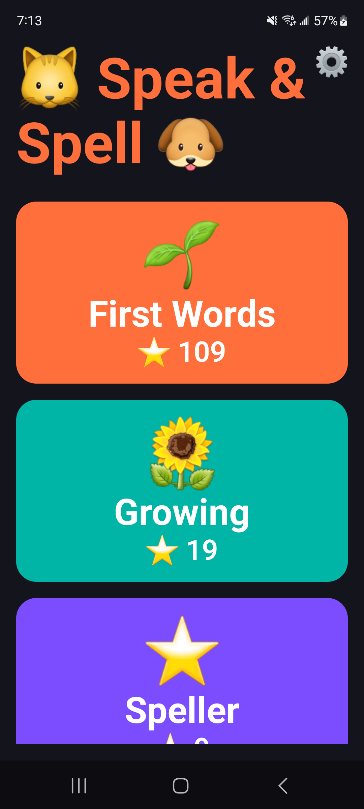
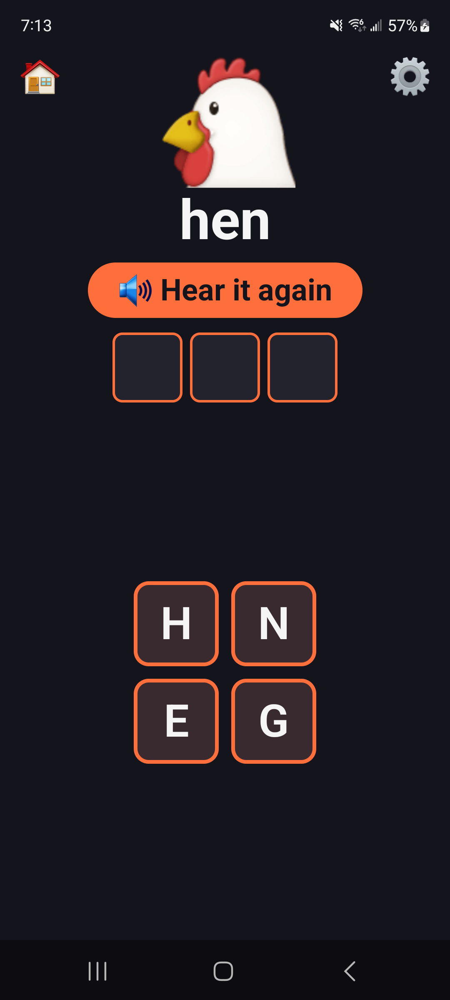
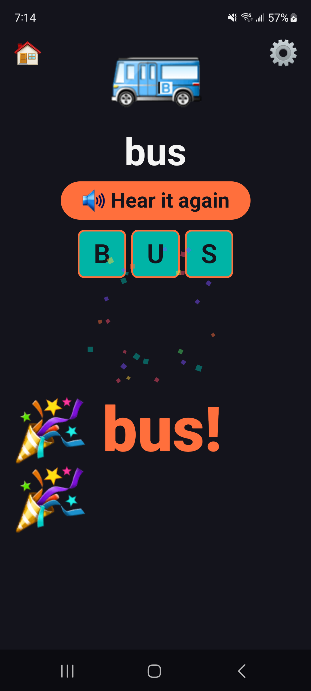
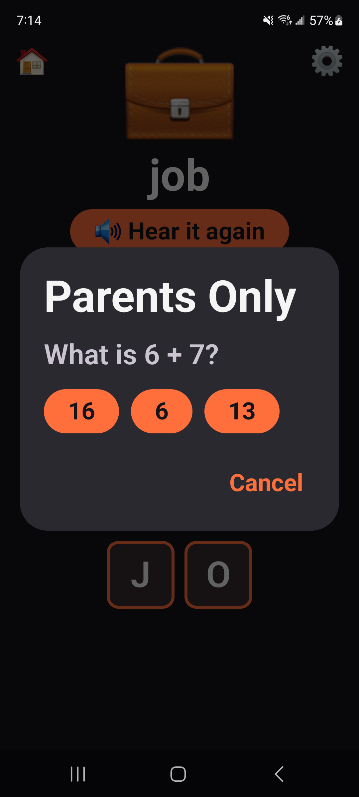
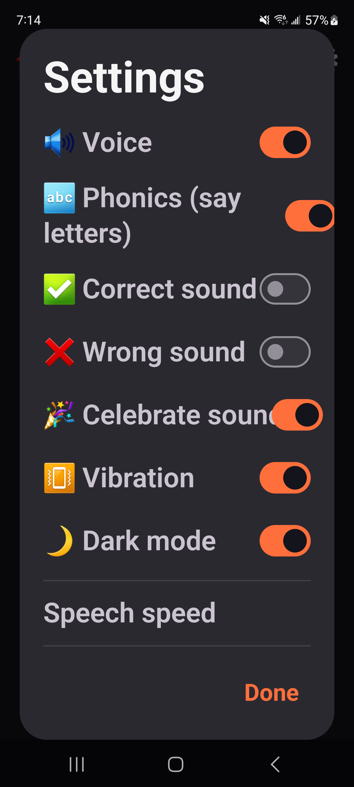

# Speak & Spell

A spelling game for kids, inspired by the classic Speak & Spell toy. The app
**speaks a word**, the child **assembles it from letter tiles**, and gets
immediate, forgiving, celebratory feedback. Built for a pre-reader — no login,
no ads, no network, fully offline.

It comes in two versions: a native Android app (`app/`), and an offline web app
(`web/`) that installs on **iPhone, iPad and Android** straight from the browser.
There's no app store involved.

## Install on your phone

Open **https://andrewlkirby.github.io/speak-n-spell/** on your phone, or scan this code
with the camera:


### iPhone / iPad

1. Open the link in **Safari**.
2. Tap the **Share** button (the square with an arrow pointing up ⬆️). On iPhone
   it's at the bottom of the screen; on iPad it's at the top.
3. Scroll down and tap **Add to Home Screen**, then tap **Add**.
4. Open **Speak & Spell** from your home screen and tap the big ▶ button.

### Android

1. Open the link in **Chrome**.
2. Tap **📲 Install app** on the banner at the bottom of the screen. If there's no
   banner, tap the **⋮** menu at the top right, then **Add to Home screen** →
   **Install**.
3. Open **Speak & Spell** from your home screen or app drawer and tap the big ▶ button.

You only need internet for the first visit. After that the app works offline, even
in airplane mode, and it updates itself the next time it's opened while online.
Stars and settings are saved on the device.

### Troubleshooting

- **No sound on iPhone:** turn off the silent switch (or Silent Mode) and turn up the volume.
- **Voice sounds robotic, or there's no voice:**
  - *iPhone:* Settings → Accessibility → Spoken Content → Voices → English, then
    download an **Enhanced** or **Premium** voice.
  - *Android:* Settings → search "Text-to-speech" → choose **Speech Services by
    Google**, then install the English voice data.
- **No "Add to Home Screen" option on iPhone:** make sure the page is open in
  Safari, not inside another app like Messages, Facebook or Gmail. In that case,
  tap the "open in Safari" (compass) icon first.
- **The banner says to install, but it's already installed:** open the app from the
  home-screen icon instead of from the browser.

## Screenshots

| Home | Spelling | Celebration |
|------|----------|-------------|
|  |  |  |

| Parent gate | Settings |
|-------------|----------|
|  |  |

## How it plays

1. The app speaks a word aloud (tap **Hear it again** to repeat it).
2. An emoji shows what the word means; the child taps letter tiles in order
   to spell it.
3. A wrong tile just shakes and says its letter — nothing is lost, no fail
   state, endless gentle retry.
4. Spelling the word correctly triggers confetti, a celebration sound, and a
   star, then auto-advances to the next word.

### Levels

| Level | Word shape | Hints shown |
|-------|-----------|-------------|
| 🌱 First Words | 3-letter (cat, dog, sun) | word text + emoji + audio |
| 🌻 Growing | 4-letter (fish, star, milk) | emoji + audio |
| ⭐ Speller | 5–7 letters (rabbit, yellow, garden) | audio only |
| 🏆 Challenge | long/tricky words (butterfly, elephant) | audio only |

Every word is paired with an emoji, so the game never requires the child to
already be able to read.

Settings (behind a parent gate — a simple math question) let a parent toggle
voice, phonics, sound effects, vibration, dark mode, and speech speed.

## Tech stack

Android:


- Kotlin + Jetpack Compose (Material 3), single-Activity
- `ViewModel` + `StateFlow`, unidirectional data flow, no network layer
- Android's built-in `TextToSpeech` for speech (free, offline)
- `SoundPool` for sound effects, haptics for feedback
- Jetpack DataStore (Preferences) for progress and settings persistence
- Min SDK 26, target SDK 35

The web app is TypeScript + Vite with no UI framework. It uses the browser's
`speechSynthesis` (on-device voices), Web Audio for sound effects,
`localStorage` for progress, and a service worker (`vite-plugin-pwa`) that
precaches everything for offline play. Its word lists, illustrations and sounds
are **generated from the Android sources** (`Levels.kt`, `res/drawable`,
`res/raw`) by `web/scripts/extract-words.mjs`. To change words for both apps,
edit `Levels.kt` only.

## Building (Android)

```bash
./gradlew assembleDebug
```

The debug APK is installed for personal use only — there's no Play Store
listing, accounts, or ads.

## Building (web)

Requires Node 22+.

```bash
cd web
npm install
npm run dev       # local dev server
npm test          # unit tests (word lists, tiles, game logic)
npm run build     # production build in web/dist
npm run preview   # serve the production build at http://localhost:4173/speak-n-spell/
```

Pushing to `main` deploys the web app to GitHub Pages
(`.github/workflows/deploy-web.yml`). One-time setup: in the repo, go to
**Settings → Pages → Build and deployment → Source** and choose **GitHub Actions**.

`npm run icons` regenerates the home-screen icons (from the Android launcher
icon) and `docs/install-qr.png`.
